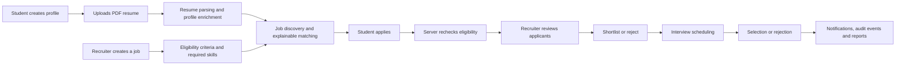

<div align="center">

# CampusLink

### One campus. Three roles. A smarter path from profile to placement.

**An AI-assisted placement and recruitment platform that connects students, recruiters, and placement teams through explainable matching and a complete hiring workflow.**

[Features](#-what-campuslink-does) · [Architecture](#-architecture) · [Get Started](#-get-started) · [Demo Accounts](#-demo-accounts) · [API](#-api-at-a-glance) · [Deployment](#-deployment) · [License](#-license)


</div>

---

## ✨ The idea

Campus placements involve many moving parts: student profiles, eligibility rules, job listings, resumes, recruiter shortlists, interview schedules, and placement-office reporting. When those steps live in disconnected tools, it becomes difficult to see what is happening and why a candidate is a good fit.

**CampusLink brings that workflow into one role-aware platform.** Students discover opportunities and understand their fit. Recruiters manage openings and evaluate applicants with evidence. Placement administrators oversee the ecosystem, approvals, drives, and outcomes.

The platform is designed around an important principle: **a match score should be explainable, and eligibility should be enforced by the backend—not guessed by the interface.**

## 🚀 What CampusLink does

### Three focused workspaces

| Workspace | What it can do |
|---|---|
| **Student** | Build a placement profile, upload and manage a PDF resume, discover jobs, review eligibility, see match explanations and skill gaps, apply, track application progress, and view interviews and notifications. |
| **Recruiter** | Create and manage jobs, publish openings, filter applicants, inspect candidate match evidence, shortlist candidates, move applications through the hiring workflow, schedule interviews, and export applicant reports. |
| **Placement Admin** | Approve recruiters, manage student records and placement drives, review platform activity, inspect audit logs, view analytics, and export student data. |

Admin is a protected backend role. Public registration is available to students and recruiters; admin accounts are provisioned separately.

### Placement workflow



### Explainable candidate matching

CampusLink compares a student's profile and resume content with a job's required skills and description. It exposes a baseline comparison rather than hiding everything behind one opaque number:

- **Keyword matching** — exact required-skill phrase coverage.
- **TF-IDF matching** — synonym-aware skill evidence, document similarity, and project/experience relevance.
- **Embedding matching** — semantic similarity using the local `Xenova/all-MiniLM-L6-v2` model (384-dimensional vectors).

When embeddings are available, the embedding score combines **50% skill coverage, 30% document similarity, and 20% project/experience relevance**. When embeddings are unavailable, the TF-IDF fallback uses **50% skill coverage, 35% document similarity, and 15% project/experience relevance**. The API returns the method used, score breakdown, matched skills, missing skills, and supporting evidence. Keyword, TF-IDF, and embedding results can be compared where embeddings are available.

These scores are decision-support signals—not guarantees of interview selection or placement.

### Built around the full workflow

- **Eligibility checks:** branch, CGPA, graduation year, and active-backlog rules are evaluated on the server. Eligibility is rechecked when a student submits an application.
- **Resume processing:** PDF validation, parsing, structured extraction, and GridFS storage. Email and phone patterns are removed before resume text is sent to the optional LLM extraction flow.
- **Application lifecycle:** `applied` → `shortlisted` → `interview_scheduled` → `selected` or `rejected`, with validated transitions and status history.
- **Interview management:** scheduling, rescheduling, cancellation/completion flows, recruiter conflict checks, and calendar data.
- **Operational visibility:** notifications, audit events, analytics, recruiter reports, and CSV exports.
- **Resilient AI assistance:** optional Groq-compatible LLM support for structured extraction, skill suggestions, and summaries, with deterministic/classical fallbacks when the provider is unavailable or not configured.

## 🧰 Technology

| Layer | Technologies |
|---|---|
| **Frontend** | React 18, Vite, JavaScript, React Router, TanStack Query, Axios, Tailwind CSS, React Hook Form, Recharts, Framer Motion, Lucide, Three.js, React Three Fiber, Drei |
| **Backend** | Node.js, Express, Mongoose, MongoDB, Zod, JWT, bcrypt, Multer, GridFS, Piscina worker threads |
| **Matching and document processing** | Transformers.js, `Xenova/all-MiniLM-L6-v2`, `natural` (TF-IDF), `pdf-parse`, synonym-aware skill matching |
| **Optional LLM integration** | OpenAI-compatible API client configured for a Groq-compatible endpoint |
| **Operations** | Pino logging, Helmet, CORS allowlist, rate limiting, Mongo sanitization, Vitest, Render, Vercel, Netlify |

The public landing page retains the supplied Fusion/Kage starter experience; CampusLink's authenticated workspaces use a coordinated charcoal/crimson visual identity with data-focused layouts.

## 🏗️ Architecture

CampusLink is an npm-workspaces monorepo. The browser application and API run as separate processes and communicate through the `/api` contract.

```text
CampusLink_Complete/
├── client/                         # React + Vite application
│   ├── api/                        # Axios client and API modules
│   ├── app/                        # Router, providers and query client
│   ├── components/                 # Shared UI components
│   ├── features/                   # Auth and role-aware features
│   ├── layouts/                    # Public and workspace layouts
│   ├── lib/                        # Shared frontend utilities
│   └── pages/                      # Public, student, recruiter and admin pages
├── server/
│   ├── scripts/                    # Model download and demo seeding
│   ├── seed/resumes/               # Synthetic demo PDF resumes
│   └── src/
│       ├── ai/                     # LLM prompts, schemas and tasks
│       ├── config/                 # Environment, MongoDB and GridFS
│       ├── embeddings/             # Profile and job embeddings
│       ├── middleware/             # Auth, validation, upload and security
│       ├── models/                 # Mongoose models
│       ├── modules/                # Auth, jobs, matching, applications, etc.
│       ├── utils/                  # Shared backend utilities
│       └── workers/                # Resume parsing and CPU-heavy work
├── docs/
│   ├── deployment/                 # Render and production checklists
│   ├── postman/                    # Postman collection and request examples
│   └── spec/                       # Project and frontend specifications
├── public/landing-pages/           # Supplied landing-page assets
├── render.yaml                     # Render API service blueprint
├── vercel.json                     # Vercel SPA configuration
├── netlify.toml                    # Netlify SPA configuration
├── vite.config.js
├── package.json                    # Workspace scripts
└── README.md
```

### Backend design

The Express API is organised by domain. Routes apply authentication, role authorization, request validation, and object-level ownership checks before calling controllers and services. Mongoose models persist users, student/recruiter profiles, jobs, applications, interviews, notifications, and audit records.

Resume PDFs are stored in MongoDB GridFS rather than the ephemeral application filesystem. PDF parsing and embedding work run in Piscina worker threads. The embedding model is downloaded during setup/deployment and loaded locally at runtime; if embeddings are disabled or unavailable, matching can fall back to TF-IDF.

### Security boundaries

- Passwords are hashed with bcrypt; JWTs are verified against the current database user.
- Backend role checks and resource ownership checks are authoritative. Frontend route guards are for navigation, not a security boundary.
- Request bodies and query parameters are validated with Zod.
- Helmet, CORS allowlisting, rate limiting, Mongo operator sanitization, upload validation, and sensitive-header redaction are enabled.
- Password hashes and stored embedding vectors are excluded from ordinary model reads.
- Resume access is scoped to the owning student or an authorized recruiter relationship.

## 📦 Get started

### Prerequisites

- **Node.js 22.22.0** is the recommended version (`.node-version`). The package engine range is `>=20.16.0 <25`.
- npm (included with Node.js).
- A MongoDB deployment. **MongoDB Atlas is recommended**; transaction-backed flows require a replica-set-capable deployment.
- Internet access for dependency installation and the initial embedding-model download.

### 1. Clone and install

```bash
git clone https://github.com/<your-account>/<your-repository>.git
cd CampusLink_Complete
npm install
```

Replace the repository URL with your GitHub repository URL.

### 2. Configure the backend

**Windows PowerShell:**

```powershell
Copy-Item server/.env.example server/.env
notepad server/.env
```

**macOS / Linux:**

```bash
cp server/.env.example server/.env
```

Open `server/.env` and set at least:

```env
MONGODB_URI=mongodb+srv://<username>:<password>@<cluster-host>/CampusLink_demo?retryWrites=true&w=majority
JWT_SECRET=replace-with-a-random-secret-at-least-32-characters-long
CORS_ORIGIN=http://localhost:5173
```

Use a dedicated database name containing `CampusLink` or `demo` if you plan to run the seed script. URL-encode special characters in the MongoDB username or password. Keep secrets in `server/.env` only; never place server credentials in a `VITE_` variable or commit them.

The rest of the settings in `server/.env.example` have development defaults. The Groq-compatible LLM configuration is optional; without a configured model and API key, the related features use their fallback behavior. Set `AI_ENABLED=false` to disable external LLM calls explicitly.

### 3. Download the local embedding model

```bash
npm run download:model
```

This downloads and verifies `Xenova/all-MiniLM-L6-v2` into `server/models/`. The model directory is ignored by Git and should not be committed. Run this once before using semantic matching or creating the complete demo dataset.

### 4. (Optional) Seed demo data

```bash
npm run seed
```

The seed script creates synthetic demo data, including:

- 1 placement admin, 4 recruiters (3 approved and 1 pending), and 25 students.
- 25 student profiles and 6 sample PDF resumes.
- 8 jobs, 15 applications across the five application statuses, 3 interviews, notifications, and audit records.

> **Destructive operation:** the seed script clears CampusLink collections and demo resume files in the configured database before inserting fresh data. It refuses to run with `NODE_ENV=production` and only accepts a database whose name includes `campuslink` or `demo`. Still, point it only at a dedicated disposable development/demo database—not a production database or a database containing information you need to keep.

### 5. Start the application

From the repository root:

```bash
npm run dev
```

This starts the API and frontend together.

| Service | Local URL |
|---|---|
| **Frontend** | `http://localhost:5173` |
| **Backend API** | `http://localhost:5000` |
| **Health check** | `http://localhost:5000/api/health` |

The Vite development server proxies `/api` requests to `http://localhost:5000` by default.

To run only one workspace:

```bash
npm run dev:client    # Frontend only
npm run dev:server    # Backend only
```

To change the local API proxy target before starting Vite:

**PowerShell:**

```powershell
$env:CAMPUSLINK_API_PROXY = "http://localhost:5001"
npm run dev:client
```

**macOS / Linux:**

```bash
CAMPUSLINK_API_PROXY=http://localhost:5001 npm run dev:client
```

The API can start in development mode without MongoDB, but database-backed features—such as login, profiles, jobs, and applications—will not function until the database connection is available. Check `/api/health` and confirm `data.db` reports `connected` before testing the workflow.

## 🔐 Demo accounts

After a successful seed, all demo users share this password by default:

```text
CampusLink@Demo2026
```

You can override it before seeding with `CAMPUSLINK_DEMO_PASSWORD` (minimum 12 characters).

| Role | Demo email | State |
|---|---|---|
| Placement Admin | `admin@campuslink.example.com` | Active |
| Recruiter | `recruiter.nexa@techcorp.example.com` | Approved |
| Recruiter | `recruiter.vertex@vertexlabs.example.com` | Approved |
| Recruiter | `recruiter.orbit@orbitdata.example.com` | Approved |
| Recruiter | `recruiter.pending@novasystems.example.com` | Pending approval |
| Student | `student01@campuslink.example.com` | Active |
| Students 2–25 | `student02@campuslink.example.com` … `student25@campuslink.example.com` | Active |

These are synthetic local-demo accounts. **Do not reuse the demo password in production or with any personal account.**

## 🔌 API at a glance

All API routes are prefixed with `/api`. Successful responses use a consistent envelope:

```json
{
  "success": true,
  "data": {}
}
```

Errors use a structured `error` object with a code and readable message. Paginated list responses also include `meta` information.

| Area | Base path | Purpose |
|---|---|---|
| Health | `/api/health` | Service, database, embedding, LLM, and memory status |
| Authentication | `/api/auth` | Registration, login, and current-user lookup |
| Students | `/api/students` | Student profile and resume operations |
| Jobs | `/api/jobs` | Job creation, discovery, publishing, eligibility, and applications for a job |
| Matching | `/api/matching` | Match explanations and method comparisons |
| Applications | `/api/applications` | Student application history and status-related operations |
| Interviews | `/api/interviews` | Interview scheduling and calendar data |
| Notifications | `/api/notifications` | Notification listing and read state |
| Administration | `/api/admin` | Recruiter approvals, students, drives, audit logs, and exports |
| Analytics | `/api/analytics` | Placement and recruitment analytics and reports |

For full request/response examples, import [`docs/postman/CampusLink.postman_collection.json`](docs/postman/CampusLink.postman_collection.json) and the environment at [`docs/postman/CampusLink.postman_environment.json`](docs/postman/CampusLink.postman_environment.json). Phase-wise examples are also available in `docs/postman/`.

## 🧪 Build and tests

Run these commands from the repository root:

```bash
npm run build              # Production frontend build
npm test                   # Backend Vitest suite
npm run test:client        # Frontend Vitest suite
npm run test:integration   # Backend workflow integration tests
npm run preview            # Preview the production frontend build
```

The frontend build is written to `dist/client/`. The API is a separate Node.js service and is not bundled into the browser build. Run the tests in your own configured environment; the presence of a test suite does not imply that every environment-specific integration (MongoDB, model download, or external LLM provider) has been exercised.

## ☁️ Deployment

The frontend and backend are deployed separately:

### Backend — Render + MongoDB Atlas

1. Push the repository to GitHub.
2. In Render, create a **Blueprint** from the repository; `render.yaml` is at the repository root.
3. Set the requested `MONGODB_URI` and exact frontend `CORS_ORIGIN` values.
4. Render installs the workspaces, downloads the local embedding model during build, starts the server workspace, and checks `/api/health`.
5. Confirm the health endpoint reports `db: "connected"` and review `embeddings`, `llm`, and `memoryMb` before the demo.

The supplied Blueprint uses a single Render instance. The embedding model consumes memory; measure the service after model warm-up. For a memory-constrained instance, `EMBEDDINGS_ENABLED=false` enables the TF-IDF fallback and skips model download at build time. See [`docs/deployment/render-deployment.md`](docs/deployment/render-deployment.md) for the detailed procedure and trade-offs.

### Frontend — Vercel or Netlify

1. Import the same repository into your static frontend host.
2. Use the root build command `npm run build` and output directory `dist/client`.
3. Set the frontend environment variable:

   ```env
   VITE_API_URL=https://<your-render-service>.onrender.com/api
   ```

4. Set the backend `CORS_ORIGIN` to the exact deployed frontend origin, then redeploy the API.

`vercel.json` and `netlify.toml` include SPA fallback rules so direct visits and refreshes on nested React Router routes resolve to the application entry point.

> **Deployment note:** the Render Free plan can spin down when idle and has a limited memory budget. It is suitable for a demonstration, not a production availability guarantee. Review the deployment checklist and choose service capacity based on measured model memory and expected traffic.

## 📚 Project documentation

- [`docs/architecture.md`](docs/architecture.md) — backend architecture, authorization rules, matching behavior, and implementation boundaries.
- [`docs/frontend-integration.md`](docs/frontend-integration.md) — frontend/API integration and role model.
- [`docs/deployment/render-deployment.md`](docs/deployment/render-deployment.md) — Render and Atlas deployment guide.
- [`docs/deployment/deploy-checklist.md`](docs/deployment/deploy-checklist.md) — pre-deploy and post-deploy checklist.
- [`docs/postman/`](docs/postman/) — Postman collection, environment, and API examples.
- [`docs/spec/`](docs/spec/) — project problem statement and frontend instruction guide.

## 🗺️ Main application routes

| Area | Routes |
|---|---|
| Public | `/`, `/login`, `/register` |
| Student | `/student/dashboard`, `/student/profile`, `/student/resume`, `/student/jobs`, `/student/jobs/:id`, `/student/applications`, `/student/interviews`, `/student/notifications` |
| Recruiter | `/recruiter/dashboard`, `/recruiter/jobs`, `/recruiter/jobs/create`, `/recruiter/jobs/:id/edit`, `/recruiter/jobs/:id/applicants`, `/recruiter/interviews`, `/recruiter/reports`, `/recruiter/notifications` |
| Placement Admin | `/admin/dashboard`, `/admin/recruiters`, `/admin/students`, `/admin/drives`, `/admin/audit-logs`, `/admin/analytics`, `/admin/notifications` |

## 🤝 Contributing

Contributions, issue reports, and practical improvements are welcome. A useful contribution should include a clear problem statement, a focused change, and tests or reproduction steps where appropriate.

1. Fork the repository and create a feature branch.
2. Keep changes scoped and follow the existing client/server workspace boundaries.
3. Run the relevant build and test commands.
4. Open a pull request describing the change, its impact, and any setup needed to verify it.

Please do not commit `.env` files, credentials, `node_modules/`, downloaded model weights, or real student/resume data.

## 📄 License

CampusLink's original project code is released under the **MIT License**. See the [`LICENSE`](LICENSE) file for the complete license text.

Third-party packages, the supplied Fusion/Kage starter, bundled assets, fonts, and the embedding model may have their own copyright and license terms. Those components remain subject to their respective licenses; the CampusLink MIT license does not replace or expand those third-party terms.

---

<div align="center">

**CampusLink — making campus hiring more connected, transparent, and actionable.**

</div>
